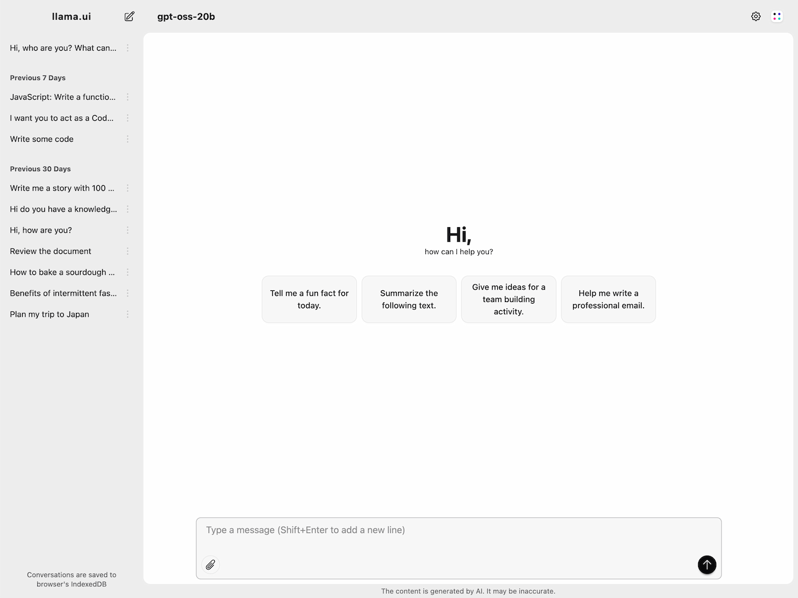

## Deploy a ChatBOT
We will learn to deploy a chat without KServe and with LLMInferenceService.   
LET'S GO:  

Think of this like a two-box system:  
📦 Model Container = model weights inside an OCI (tinygpt, qwen2.5, or smolgpt)
⚙️ Server Container = Runs llama.cpp as runtime and server.
  
 

**OCI**:  
https://www.docker.com/blog/oci-artifacts-for-ai-model-packaging/
  
**KServe OCI Container**:  
https://kserve.github.io/website/docs/model-serving/storage/providers/oci?utm_source=kapa#example
  
**TinyGPT2:**  
https://huggingface.co/collections/Qwen/qwen25

