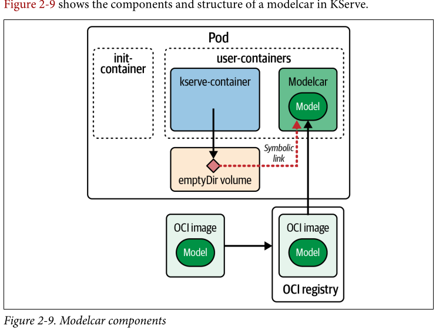

### Step1: Pull SmolGPT in an OCI Container  

We will learn to deploy a chat without KServe and with LLMInferenceService.   
  
LET'S GO:  
  
Goal: Zero-Copy AI  
❌ COPY 750GB = 🐢  
✅ READ 750GB = 🚀  
  
⚠️ Copying 750GB to every pod is a bottleneck. Reading directly is the fix.  
         

  

Packaging Ai models as OCI images enables Kubernetes nodes to decouple layers.    
Instead of using emptyDir, KServe uses symlinks to achieve this.   

⚠️ Manually orchestrating container sidecars and process namespaces across hundreds of production workloads is unmaintainable. 
KServe Example:  
https://kserve.github.io/website/docs/model-serving/storage/providers/oci?utm_source=kapa#example
    
KServe abstracts this complexity through its core storage initializer controller. 
When a deployment manifest specifies an `oci://` storage URI schema, KServe intercepts the admission request. By enabling the `enableModelcar` parameter within KServe's global configuration (`inferenceservice-config`), the system's mutating admission webhook dynamically transforms the Pod specification at runtime. It automatically injects the shared `emptyDir` memory spaces, provisions the modelcar sidecar container, and appends the requisite symbolic linking logic (`ln -s /proc/...`) without requiring manual operator intervention.

